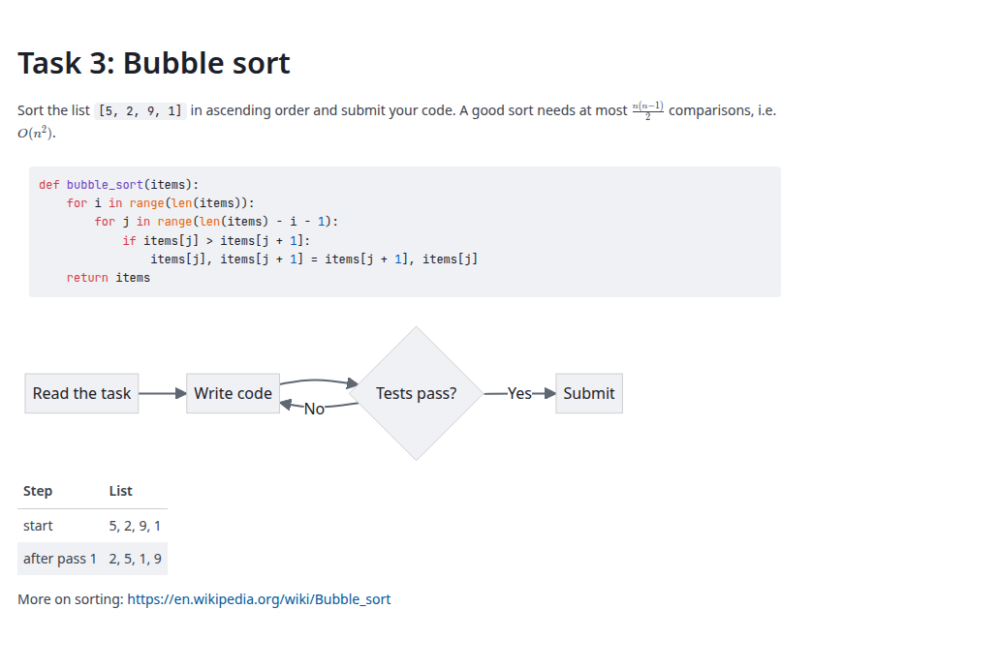

# Edrys Markdown-it Module

Show task descriptions and other Markdown content in an Edrys class. The module renders Markdown with
[markdown-it](https://github.com/markdown-it/markdown-it) and adds formulas, code highlighting, diagrams and
embedded HTML (e.g. videos). It is shown in every room (`show-in: *`) and has no shared state: every peer renders
the content from the module configuration. The module follows the classroom's light or dark theme, code
highlighting and Mermaid diagrams included.



## Usage

Add the module to your class with this URL:

```
https://edrys-labs.github.io/module-markdown-it/index.html
```

Alternatives, if you prefer loading from GitHub directly:

- the same module, inlined by Edrys:
  `https://raw.githubusercontent.com/edrys-labs/module-markdown-it/refs/heads/main/index.html`
- the YAML declaration, for Edrys versions that support YAML modules:
  `https://raw.githubusercontent.com/edrys-labs/module-markdown-it/refs/heads/main/module.yaml`

## Configuration

Open the module in the class settings. Each of the four tabs has one **content** field:

| Tab | Shown to |
|-----|----------|
| General (`config`) | everyone |
| Teacher (`teacherConfig`) | teachers |
| Student (`studentConfig`) | students |
| Station (`stationConfig`) | stations |

Each role sees the general content **followed by** the content of its own tab. Empty tabs are skipped. Changes are
shown to everyone as soon as the settings are saved.

If you edit the class configuration as YAML instead, use a literal block (`|`), so that line breaks, and with them
code blocks and diagrams, are kept:

```` yaml
config:
  content: |
    # Main document

    This text is shown to all users, followed by the content for their role.

    Formulas: $\frac{12}{x}$

    ```mermaid
    graph LR
      A[Read the task] --> B[Solve it] --> C[Submit]
    ```
studentConfig:
  content: |
    Only students see this part.
````

Don't use a folded block (`>-`): it joins lines, which breaks code blocks and diagrams.

## Features

* __Markdown__ with [typographer](https://github.com/markdown-it/markdown-it#typographer) replacements and
  automatic links for bare URLs. Markdown links open in a new tab, so the module keeps its content. Links to
  headings on the same page (`#...`) stay in place.
* __HTML__ can be used inside the content, for example to embed a video:

  ```` markdown
  <iframe width="560" height="315" src="https://www.youtube.com/embed/BdKyq56Cijo"
    title="YouTube video player" frameborder="0" allowfullscreen></iframe>
  ````

  HTML links are left as written; add `target="_blank"` yourself if they should open in a new tab.
* __Code highlighting__ with [highlight.js](https://highlightjs.org/):

  ```` markdown
  ```python
  print("hello")
  ```
  ````

* __Formulas__ with KaTeX: `$formula$` inline, or `$$formula$$` as a block.
* __Mermaid__ (recommended for diagrams, rendered in the browser):

  ```` markdown
  ```mermaid
  graph TD
    A[Start] --> B{Is it working?}
    B -- Yes --> C[Great]
  ```
  ````

  Mermaid covers flowcharts, sequence, class, state and Gantt diagrams, among others; see the
  [Mermaid documentation](https://mermaid.js.org/intro/).

The following diagram types are **not** rendered in the browser: their source is sent to the public
[PlantUML server](https://www.plantuml.com) (`www.plantuml.com`), which returns the image. Every viewer's
browser makes that request, so don't put confidential content in these diagrams, and check whether your
institution allows it. Prefer Mermaid where it can express the same diagram.

* __PlantUML:__

  ```` markdown
  ```plantuml
  Bob -> Alice : hello
  ```
  ````

* __DOT:__

  ```` markdown
  ```dot
  digraph example1 {
    1 -> 2 -> { 4, 5 };
    1 -> 3 -> { 6, 7 };
  }
  ```
  ````

* __ditaa:__

  ```` markdown
  ```ditaa
  +--------+   +-------+    +-------+
  |        +---+ ditaa +--> |       |
  |  Text  |   +-------+    |diagram|
  |Document|   |!magic!|    |       |
  |     {d}|   |       |    |       |
  +---+----+   +-------+    +-------+
      :                         ^
      |       Lots of work      |
      +-------------------------+
  ```
  ````

## Development

There is no build step: `index.html` and `module.yaml` load all libraries from CDNs with pinned versions. Both files
contain the same script, so a change to one has to be made in the other as well.

## License

[MIT](LICENSE) © edrys-labs
